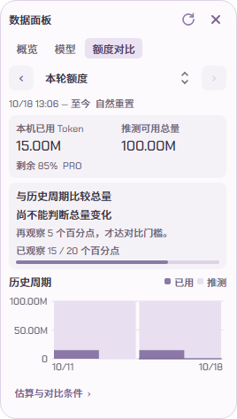
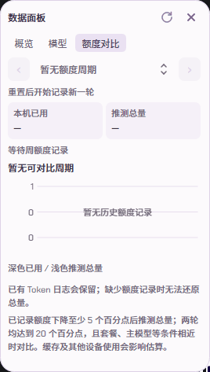

# 程序补丁包 1.0.1

- **额度对比重新分区**：本机用量、历史总量对比与历史周期图各自成区，完整条件按需展开。明确区分“观察下降 5 个百分点后估算总量”和“覆盖至少 20 个百分点才具备历史对比条件”，新增观察进度条。
- **新增 WSL Codex 接入**：Windows 桌宠可读取所选发行版中的会话、Token 和完成状态，通过 Linux CLI 查询额度，并在终端打开 Linux 会话。
- **补齐独立补丁更新**：程序与动画补丁共用公开版本序列，按所需内容更新，已有有效动画不重复下载。
- **修复数据面板高度**：额度对比切回概览不再缩短面板。

图片和动图均使用模拟统计数据；动图展示原生测试窗口切页，不作为显示帧率证明。

## 下载与升级

已有用户优先通过软件内更新。手动升级或首次安装，请下载 **程序补丁安装器 1.0.1**（文件名以 `windows-x64.zip` 结尾），解压运行“一键部署.exe”。`program.zip` 和 `program.json` 仅供软件内更新使用，不要直接覆盖安装目录。

本次安装器不含动画。已有用户复用可校验的本机素材，设置、统计和回退版本保留；新用户先获得卡片程序，可在设置中下载人物素材。本次没有重新上传动画资源。

## WSL 使用与边界

设置 → Codex → 连接路径与检测报告，选择 WSL、刷新并选择发行版，验证并保存路径后重启。详见 [WSL 接入说明](https://github.com/Wunsch2048/codex-bailong-desktop-pet/blob/main/docs/WSL.md)。

WSL 完成提醒需手动确认，未实现 Linux 进程启动/退出联动。本机没有 WSL，20 项适配器/传输等检查及 Windows 界面验证已通过；真实发行版登录、共享目录和额度查询仍待实机确认。WSL issue 保持开放。Mac 移植仍在 PR 审查中，本次没有 Mac 安装包。

本轮额度/报告界面 27 项检查、四档 DPI 布局通过；发布构建另核对冻结模块、离线 TLS、原生交互、程序与安装器校验。原项目：[jingh12312-rgb/bailong-desktop-pet](https://github.com/jingh12312-rgb/bailong-desktop-pet)。
